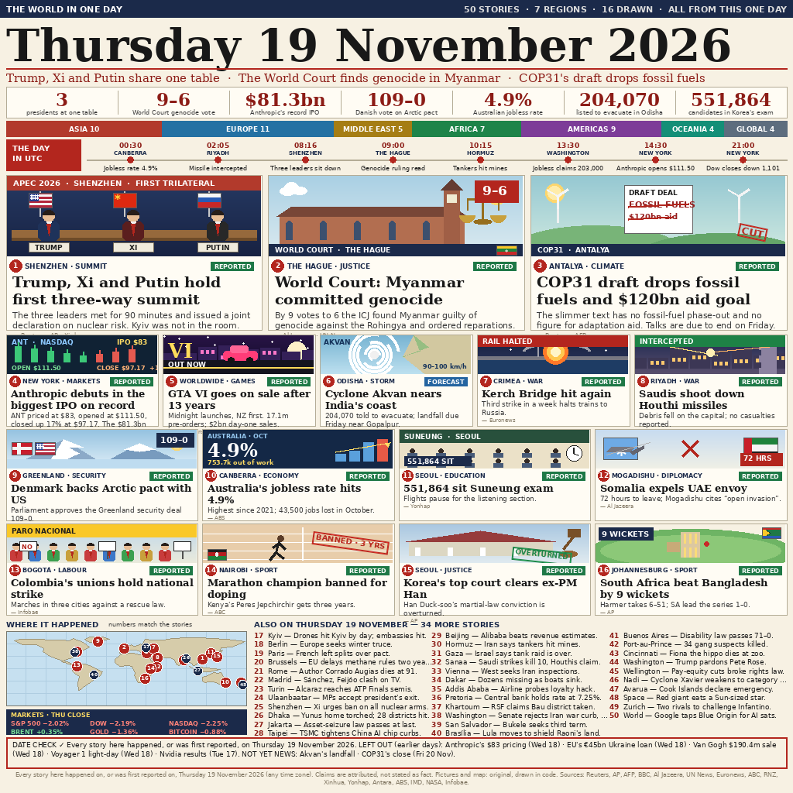

# Thursday 19 November 2026 — The World in One Day

One-page newspaper summing up the world's news of Thursday 19 November
2026, built for the [make.fun bounty](https://make.fun/bounty/news-image-20261119).

## What's on the page

- **50 stories from 7 regions** — Asia 10, Europe 11, Middle East 5,
  Africa 7, Americas 9, Oceania 4, Global 4.
- **16 illustrated stories**, all drawn in code: the first Trump–Xi–Putin
  trilateral in Shenzhen, the World Court's 9–6 genocide ruling on
  Myanmar, the COP31 draft, Anthropic's record IPO, GTA VI's launch,
  Cyclone Akvan, and more.
- **Numbers strip** (3 presidents, 9–6, $81.3bn, 109–0, 4.9%, 204,070,
  551,864), **region bar**, **UTC timeline** of the day, **pin map**,
  **markets close** (S&P −2.02%, Dow −1,101, Nasdaq −2.25%, Brent $92.27,
  gold $3,675, Bitcoin $61,974).
- **34 briefs** with sources, and a **DATE CHECK** footer that names what
  was deliberately left out (stories first reported on 18 November or
  earlier, and events not yet news on the 19th).
- Every story carries a proof tag: REPORTED (confirmed by named sources),
  CLAIM (one side's account), or FORECAST (outlook, draft or schedule).

## How it works

- `render_v3.py` draws `entry.png` (1024×1024, under 1 MiB) with Pillow.
  Run it with `python3 render_v3.py`.
- `main.py` is the entrypoint: it copies the committed `entry.png` to
  `$MAKEFUN_OUTPUT_DIR` (default `/output`) using only the standard
  library, so both grading runs write identical bytes.

Every story on the page happened, or was first reported, on Thursday
19 November 2026 in some time zone. Claims are attributed, not stated
as fact. Pictures and map are original, drawn in code.

## License

MIT — see [LICENSE](LICENSE).
